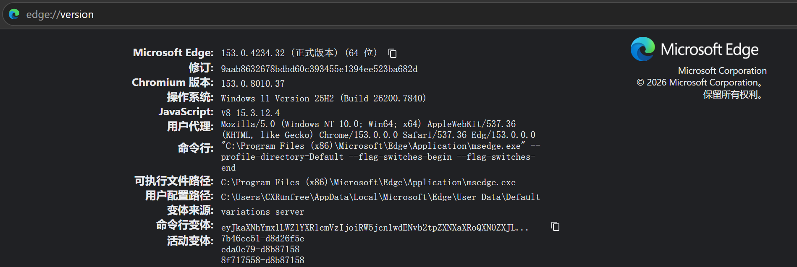

##  Autovisor

**Github项目主页：**[liu-yuzheng/Autovisor](https://github.com/liu-yuzheng/Autovisor)（上游项目：[CXRunfree/Autovisor](https://github.com/CXRunfree/Autovisor)）

------
#### 2026/11/8 公告

#### 2026/9/19 Autovisor-GUI 0.1更新

**本次更新:**

-修复隐藏窗口


#### 💗赞助商
期待你的赞助
------
#### 一、程序介绍

**项目简介:**

前项目Autovisor是一个可无人监督的自动化程序, 基于微软的 Playwright 框架, 由 Python 和 JavaScript 编写而成. 核心原理是使用浏览器模拟用户操作.

本项目在前项目的基础上加了一层图形界面,并进一步实现自动化。

**程序功能:**

- **支持自动登录**
- **自动通过滑块验证(可选)**
- **自动播放和切换下一集**
- **跳过弹窗和弹出的题目**
- **自动静音、调成指定的倍速**
- **检测视频是否暂停并续播**
- **支持自动刷习惯分**
- **不知道支不支持智慧共享课**
- **不知道支不支持翻转课**
- 检测当前学习进度并后台实时更新
- 完成章节时将提示已刷课时长
- 各种自定义配置

与源项目相比，新增了:**

- **图形界面**: 运行、配置、帮助三个页签, 可视化查看本课与总进度、状态灯与实时日志
- **隐藏浏览器窗口**：不美观的隐藏浏览器窗口，实际上会有一个最小的窗口在左下角
- **小窗监视**: 新增小窗功能，方便用户监视当前进度，能将左下角的窗口遮住
- **失败自动重启**: 出错或课时未被平台确认完成时, 按阶梯间隔自动重启刷课核心Autovisor .
- **开机自启动**: 写入当前用户的启动项, 开机那次直接以左下角小窗开始刷课.
- **每日时长上限**: 当天累计刷满 N 分钟后, 再开机就静默跳过.
- **单实例运行**: 重复启动只会唤出已有窗口, 不会两份程序抢同一门课.

#### 二、使用须知

1. 请确保系统为 Windows 10 及以上.

**发行版目录说明:**

- `resources/`: 图片、脚本等程序资源.
- `packages/`: 自动下载的 NumPy、OpenCV 等运行时依赖.
- `data/`: 登录 Cookies 和镜像源配置.
- `ui_text.py`: 界面显示的全部文字, 可直接编辑.

#### 三、发行版下载

- Github: [Releases · liu-yuzheng/Autovisor](https://github.com/liu-yuzheng/Autovisor_GUI/tree/main)
- 网盘备用: [蓝奏云 · Autovisor_GUI-for-windows](https://wwbuo.lanzouq.com/b01i5zscwd) 密码: 492l

这是已经打包好的程序, 若需要**源代码**请于 [Github 项目主页](https://github.com/liu-yuzheng/Autovisor_GUI/tree/main)下载.

***-------测试环境为Windows11，edge浏览器，共享课，其他环境可能会不适配，以下仅供参考-------***

#### 四、图形界面

界面只是 `config.ini` 的另一种编辑方式, 两者共用同一份配置, 用哪个都行.

1. **启动**

   - 源码: `python GUI.py`, 要求 Python 3.10~3.13, 且解释器自带 tkinter; 缺依赖时程序会自己装(可在配置里用 `autoInstallDeps` 关掉).
   - 打包: `python build.py --gui`, 产物在 `dist/AutovisorGUI/`, 双击 exe 即可.

2. **配置页**

   账号、密码、浏览器、课程链接、倍速、时长与各开关都能直接改. 没有「保存」按钮: 停手约 0.6 秒就会写回 `config.ini`, 点「开始运行」前还会再核一次. 运行过程中配置页锁定, 停止或结束后自动解锁.

3. **开机自启动**

   配置页只有一个「开机后在左下角小窗自动开始刷课」开关, 勾上等于三件事: 写入当前用户的启动项(HKCU 下的 Run 键, 不需要管理员权限)、开机那次只在工作区左下角显示小窗(`--mini`)、就绪后直接开始刷课(`--boot`). 程序目录被移动后再启动, 会自动把注册表路径改成新位置.

   勾选后才展开两项设置:

   - 「每天刷满 N 分钟后不再自启动」(默认 60, 0 表示不限制): 只累计真正在刷课的时间(含失败重试等待), 空闲、停在配置页、程序没开都不算; 当天达到上限后再开机就静默跳过, 不弹窗也不开浏览器, 结果记在 `logs/boot.log`, 当天的累计时长存在 `%LOCALAPPDATA%\AutovisorGUI\daily_state.json`; 旁边的进度条显示今日已刷 / 上限, 「清零」可把当天记录归零.
   - 「每次运行 N 分钟」: 单次最长刷课时间.

   手动双击启动不受每日上限限制.

4. **小窗与后台运行**

   点「小窗」隐藏主界面, 只留一个无边框浮窗显示进度和一行状态, 默认停在工作区左下角, 可拖动; 单击返回主界面, 右键可退出.

   「运行时隐藏浏览器」是把浏览器窗口缩到最小并移到屏幕左下角之外, 不是最小化, 同时会钉住页面的可见性状态, 因此播放不会因为窗口不可见而暂停.

5. **单实例**

   同一时间只允许一个实例(命名互斥锁 `Local\AutovisorGUI.SingleInstance`). 重复启动, 包括开机自启撞上手动启动, 只会把已有窗口唤到前台, 不会另开一份浏览器抢同一门课的进度.

6. **失败自动重启**

   默认开启, 等待阶梯为 `10,10,10,20,20,30` 秒(共 7 次尝试, 累计 100 秒), 可在 `config.ini` 的 `[restart]` 段调整; 留空 `backoffSchedule =` 即失败不重试. 依赖装不上、配置无效、课程链接为空这类问题不会重试, 会直接给出原因. 重试期间界面与小窗显示倒计时, 点「停止」可立即中断.

7. **界面文字**

   全部集中在 `ui_text.py`: 窗口标题、页签、按钮、提示、弹窗、帮助页、日志前缀都在里面, 改完重启程序即生效. 带 `{花括号}` 的是占位符(账号、分钟数、错误原因等), 可以调整前后文字, 但花括号里的名字不要改. 打包后 `ui_text.py` 会随程序复制到 exe 同目录, 程序优先读这份外部文件, 之后改文案不必重新打包.

8. **帮助页**

   「帮助」页签里是使用说明与常见概念, 最下方是赞赏码(`resources/QRcode.jpg`).

#### 五、macOS 源码运行

需要 macOS 和系统 Chrome. 先复制模板并填写配置:

```bash
cp config.macos.ini.example config.macos.ini
```

打开 `config.macos.ini`, 填入课程链接 (账号密码可留空, 用浏览器手动登录), 然后运行:

```bash
./run_macos.sh
```

首次运行会自动部署环境 (安装 `uv`、依赖和必要的浏览器), 之后直接启动. 环境或配置变化时会自动重新部署, 也可用 `./run_macos.sh --setup` 强制重建.

> 图形界面依赖 tkinter, 目前只在 Windows 上验证过, macOS 建议直接用配置文件运行.


#### 六、常见问题

1. 为什么解压后没有 Autovisor.exe / 运行报错**缺失依赖文件**?

   - 可能是被杀毒软件误杀了, 考虑暂时关闭杀毒软件.

2. 为什么会出现一个命令行黑框?

   - 命令行版需要这个黑框来显示运行状态. 图形界面版打好的 exe 不会弹黑框, 它的输出在界面的日志区和 `logs/stdout.txt`.

3. 为什么第一次启动就失败了?

   - 首次启动会检查并下载运行时依赖, 请等待后台日志完成. 如果下载失败, 程序会自动尝试 `data/mirrors.json` 中的下一个镜像源.

4. 为什么运行程序只出现后台却没出现浏览器界面?

   - 加载需要时间, 只要后台未异常退出就不必担心; 如果报错可能是你的浏览器安装路径有问题.

5. 我想自定义要启动的浏览器, 但是找不到装在哪里?

   - 打开你的浏览器, 在地址栏中输入 `chrome://version` 回车之后, 如图的"可执行文件目录"就是浏览器安装目录了.

   <p align="left"></p>

6. 关于弹题关不掉 / 程序卡住的问题:

   - 因为弹题是时刻有可能发生的, 而弹题检测不是时刻都进行, 所以这个问题不能完全消除;
   - 程序使用异步任务进行答题检测. 如果页面长时间没有响应, 请先确认浏览器没有被最小化.

7. 我已经打赏过了, 不希望再弹赞赏码怎么办?

   - 感谢您对本项目的支持~ 只需要设置 `showDonateCode = False` 就好了!

8. 改了 `ui_text.py` 界面却没变化?

   - 需要重启程序. 若用的是 exe 且目录里没有 `ui_text.py`, 说明当前版本还在用内置文案, 重新打包一次, 或从源码拷一份放过去.

9. 开机后没有自动开始刷课?

   - 先看 `logs/boot.log`; 若是"已达每日上限", 说明今天的累计时长已经刷满, 可以在配置页点「清零」, 或把上限改成 0. 另外请确认「开机后在左下角小窗自动开始刷课」仍然勾选.

#### 已知问题

- **长时间挂机**有概率弹出人机验证, 程序检测到后会暂停操作, 直到手动验证完成;
- 若出现其他异常崩溃, 请提交 issue 并附上报错信息.

#### 写在最后

觉得体验还不错? 请留下你宝贵的 Star ⭐, 并分享给更多有需要的人!

或者为项目发电支持一下~

原作者赞赏码：

<p align="left"></p>

我的赞赏码：
<p align="left"></p>

**声明：本程序只可用于学习和研究计算机原理, 请于 24h 内删除所有存档！**
